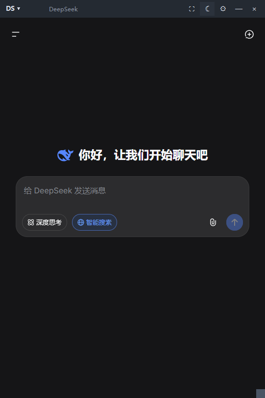

# WebFloat

把网页钉成桌面浮窗。按下快捷键，窗口弹出、光标已在输入框里，直接开聊。

为「网页版 AI 聊天」设计：不用开浏览器、不用在标签页之间找，一个置顶小窗常驻桌面边缘，随叫随到。



## 这个工具解决什么

网页版 AI（DeepSeek、Kimi、通义……）的能力和 App 版常常不一样，而且更新更快。但每次要用都得：开浏览器 → 找标签页 → 切窗口。手上正在做别的事时尤其难受。

WebFloat 把选定的网页装进一个自绘的桌面浮窗：

- 全局快捷键一键呼出，**光标直接落在输入框**，抬手指就能打字
- 无边框置顶，不抢地方，用完一键收起
- 多个站点侧身切换，各自登录态互不干扰
- 只占用系统自带的 WebView2 内核，**不打包一整个 Chromium**。实测空闲时私有内存约 280 MB（相当于一个浏览器标签页），CPU 占用 0%

## 功能

| 能力 | 说明 |
|---|---|
| 无边框置顶浮窗 | 顶部工具栏按住即可拖动；右下角把手拖动改尺寸，**尺寸和位置自动记住** |
| 一键还原比例 | 工具栏 ⛶，立刻回到默认尺寸并归位屏幕右下角 |
| 启动 / 显隐快捷键 | `Ctrl+Alt+D` 启动或唤出（含焦点自动落输入框）；`Alt+\`` 显示 / 隐藏 |
| 唤起即能打字 | 窗口显示后自动把焦点交给网页并把光标定位到输入框 |
| 多站点 | 顶部 `DS ▾` 菜单切换 / 添加 / 删除网址，各自独立登录态 |
| 夜间 / 日间模式 | 一键切换，界面配色与网页主题同步（跟随系统配色） |
| 开机自启动 | 设置里勾选即可，走系统启动文件夹 |
| 可自定义快捷键 | 设置窗口里点「修改」后直接按新组合键 |
| 托盘常驻 | 关闭只是收起，右键托盘退出 |
| 登录态持久化 | 登录一次长期有效；若环境不支持可切换为临时模式 |

## 快速开始

**需要**：Windows 10/11（自带 Edge WebView2 运行时）、Python 3.10+

```bat
:: 1. 双击 install.bat（自动创建 .venv 并安装依赖）
:: 2. 双击 launch.vbs 启动
```

手动安装：

```bash
python -m venv .venv
.venv\Scripts\python.exe -m pip install -r requirements.txt
.venv\Scripts\pythonw.exe ds_popup.py
```

## 快捷键

| 按键 | 作用 |
|---|---|
| `Ctrl+Alt+D` | 启动 / 唤出浮窗（程序没运行时按下即启动） |
| `Alt+\`` | 显示 / 隐藏 |
| `Ctrl+Alt+R` | 重新加载页面 |
| `Esc` | 收起浮窗（仅在浮窗处于前台时响应） |
| `Ctrl+Alt+Q` | 退出程序 |

全部可在 ⚙ 设置里修改。注意：**启动键**由 Windows 快捷方式承载，只能 `Ctrl/Alt/Shift + 字母、数字或 F1–F12`；**显示 / 隐藏键**没有这个限制，可以用反引号等符号键。

## 使用

- **拖动窗口**：按住顶部工具栏空白处拖动
- **改大小**：拖右下角小方块
- **还原比例**：点 ⛶
- **换站点**：点左上角 `站点名 ▾`
- **加网址**：同一个菜单里「添加网址…」
- **删网址**：菜单里「删除当前网址」
- **夜间模式**：点 ☾ / ☀
- **改快捷键 / 开机自启**：点 ⚙

## 配置

首次运行会在程序目录生成 `ds_popup_config.json`：

```jsonc
{
  "sites": [{"name": "DeepSeek", "url": "https://chat.deepseek.com", "short": "DS"}],
  "active": 0,
  "window": {"width": 480, "height": 820, "x": null, "y": null},
  "theme": "dark",                 // dark / light
  "always_on_top": true,
  "hotkeys": {
    "toggle": "alt+`",             // 显示 / 隐藏（任意组合键）
    "reload": "ctrl+alt+r",
    "quit": "ctrl+alt+q",
    "hide": "esc"
  },
  "launch_hotkey": "ctrl+alt+d",   // 启动键（受快捷方式限制）
  "persistent_profile": true,      // false = 临时模式，每次需重新登录
  "webview_args": "--no-sandbox",  // WebView2 启动参数
  "autostart": false
}
```

## 常见问题

**窗口打开是白屏 / 一直转圈？**
把 `persistent_profile` 改成 `false` 试试；仍然不行就把 `webview_args` 设为 `--no-sandbox`（个别机器上 Chromium 的渲染进程沙箱起不来）。

**启动快捷键按了没反应？**
快捷方式热键由资源管理器注册，刚设置完需要**注销或重启一次**。另外开始菜单里的 `WebFloat` 快捷方式是它的载体，删掉热键就失效（重新启动程序会自动补回来）。

**不想显示在任务栏 / 想改默认尺寸？**
直接改配置文件，或拖动窗口后点 ⛶ 还原。

**登录态丢了？**
`persistent_profile` 必须为 `true`，且不要删除程序目录下的 `webview_profile` 文件夹。

## 实现要点

不依赖 Electron —— 程序只有 1 个 Python 文件（约 1000 行），通过 `pythonnet` 直接宿主 WinForms + 系统 WebView2：

- **窗口**：`FormBorderStyle.None` 无边框，顶部栏用 `WM_NCLBUTTONDOWN + HTCAPTION` 实现拖动，右下角把手自绘缩放
- **布局坑**：WebView2 是原生子窗口，永远画在最上层，用 `Dock=Fill` 会啃掉工具栏底部（表现为一条白线），必须显式 `Location/Size` 定位
- **主题**：`CoreWebView2Profile.PreferredColorScheme` + 自绘 UI 配色同步切换
- **唤起即打字**：`wv.Focus()` + 注入 JS 聚焦页面输入框
- **启动键**：`win32com` 创建带 `Hotkey` 的快捷方式放在开始菜单（快捷方式热键只在该位置注册）；程序已在运行时，后启动的实例通过本地 socket 通知已有实例把窗口唤到前台
- **初始化**：`WebView2` 控件不会自动初始化，必须显式 `EnsureCoreWebView2Async()`，且**只能在 UI 线程调用**

开发过程中踩的坑基本都写在 `ds_popup.py` 的代码注释里。

## 已知限制

- 仅 Windows（依赖 WinForms + WebView2 运行时）
- 需要系统已安装 Edge WebView2 运行时（Win10/11 通常随 Edge 自带）
- 启动键受 Windows 快捷方式热键规则限制，不能用符号键（如反引号）
- 网页主题跟随系统配色，若在站点内手动选过深/浅色，本站点的跟随会失效

## License

MIT
